<div align="center">

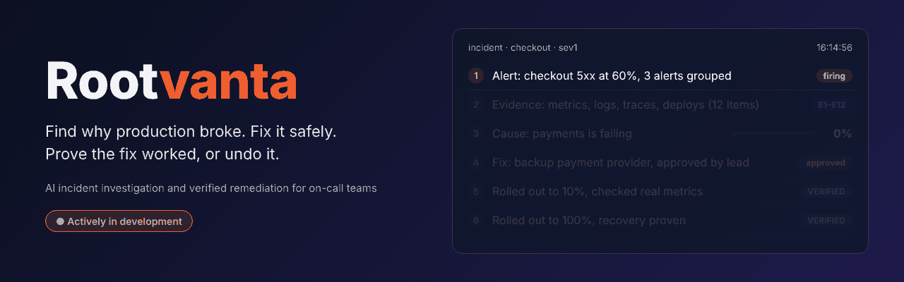

<br />
<br />

<a href="https://github.com/anchalrajput25/rootvanta/stargazers"></a>&nbsp;
&nbsp;
&nbsp;
&nbsp;
&nbsp;


<br />


<br />
<br />

<a href="#quick-start">Quick Start</a>&nbsp;&nbsp;&bull;&nbsp;&nbsp;<a href="#features">Features</a>&nbsp;&nbsp;&bull;&nbsp;&nbsp;<a href="#how-it-works">How It Works</a>&nbsp;&nbsp;&bull;&nbsp;&nbsp;<a href="#integrations">Integrations</a>&nbsp;&nbsp;&bull;&nbsp;&nbsp;<a href="#benchmarks">Benchmarks</a>&nbsp;&nbsp;&bull;&nbsp;&nbsp;<a href="#architecture">Architecture</a>&nbsp;&nbsp;&bull;&nbsp;&nbsp;<a href="#roadmap">Roadmap</a>&nbsp;&nbsp;&bull;&nbsp;&nbsp;<a href="CHANGELOG.md">Changelog</a>

</div>

---

> [!NOTE]
> **Rootvanta is actively being built.** Milestones 1 to 10 are done and tested, and new features land every week. Follow the [Roadmap](#roadmap) and the [Changelog](CHANGELOG.md) to see what is coming next. Stars and feedback are very welcome.

## What's New

- **Alert grouping**: alerts from one outage become one incident, using the learned dependency map
- **Service map**: a live map of which service calls which, learned from traces, with open incidents highlighted
- **Incident memory**: "Seen before" notes say what fixed the same cause last time, and warn when the same fix already failed
- **Each service's own normal**: catches small rises on steady services and stays quiet on noisy ones
- **Argo CD and Kubernetes**: real rollbacks and scaling, routed to whichever system the company connected
- **Company sign-in (SSO)**: Google Workspace, Microsoft Entra ID, Okta or any OpenID Connect provider
- **Helm chart and Argo CD manifest**: install it on your own Kubernetes cluster

See the full [CHANGELOG](CHANGELOG.md) for every milestone.

---

## Why Rootvanta?

When an alert fires at 3 a.m., the on-call engineer spends 30 to 60 minutes doing the same thing every time: opening dashboards, reading logs, following traces, checking what was deployed, guessing a cause, trying a fix, and then staring at graphs hoping it worked.

AI agents can now do the digging. **But almost none of them check whether the fix actually worked.** They report "resolved" because a command ran, while users still see errors. A tool that says "fixed" when it is not is worse than no tool at all.

**Rootvanta closes the loop.** It investigates with cited evidence, proposes a fix from a safe list, waits for a person to approve, rolls it out to 10% first, checks real metrics against explicit targets, and **undoes the fix by itself if it did not work**.

| Without Rootvanta | With Rootvanta |
|:---|:---|
| Engineer paged, context-switches, opens five tools | Evidence from metrics, logs, traces and deploys is collected in seconds |
| An AI names a cause with no proof | Every cause has a confidence score and cites evidence (E1, E2…) with the query that reproduces it |
| Ten alerts from one outage page ten people | Alerts are grouped into one incident using the dependency map |
| Run a fix and hope | Practice run first, approval by a different person, gradual rollout |
| "The rollback ran, so it's fixed" | Real metrics are checked against targets; a failed fix is undone automatically |
| Same failure, different engineer, same mistake | "Seen before" says what worked last time, and warns when a fix already failed |
| One shared login, data mixed together | Companies, teams, roles, SSO, encrypted tokens and an audit log |

<div align="center">

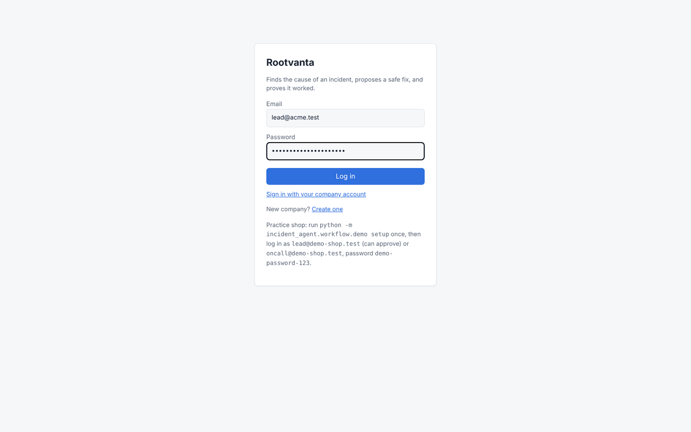

<sub>Investigation &rarr; seen before &rarr; verified fix &rarr; undone fix &rarr; grouped alerts &rarr; service map &rarr; settings (real screenshots of the dashboard)</sub>

</div>

### What makes it different

Most AI SRE tools stop at "here is the likely root cause". Rootvanta is built around one measurable promise: **never report a recovery that did not happen.**

| | Typical AI incident agent | Rootvanta |
|:---|:---|:---|
| Root cause with evidence | ✅ | ✅ cited evidence ids, "not enough evidence" below 60% |
| Proposes a fix | ✅ | ✅ chosen in code from an allowlist, checked by a safety policy |
| Proves the fix worked | ❌ | ✅ VERIFIED / PARTIALLY VERIFIED / FAILED / UNVERIFIED from real metrics |
| Undoes a bad fix by itself | ❌ | ✅ after every rollout stage |
| Publishes its false-success rate | ❌ | ✅ 0% on the scorecard, baseline 100% |
| Works without a paid AI model | ❌ | ✅ fast rule engine; Claude is optional |

---

## Features

<table>
<tr>
<td width="50%" valign="top">

### Investigation with cited evidence

A LangGraph pipeline collects evidence from Prometheus, Loki, Jaeger, deploy history and feature flags, screens log text for hidden instructions, builds a timeline, and ranks causes (bad deploy, failing dependency, overload) with a confidence score. Every claim cites evidence ids, and the evidence for **and against** each cause is shown.

</td>
<td width="50%">

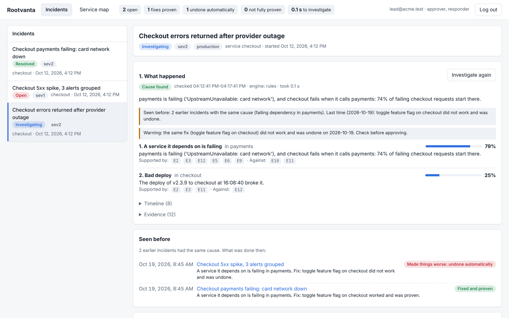

</td>
</tr>
<tr>
<td width="50%" valign="top">

### Safe fixes, approved by a person

The fix is picked in code from an allowlist (roll back, turn on a fallback from the runbook, or add replicas) and must pass every safety rule: same company and team, allowed role, allowlisted action, reversible, limited blast radius. A practice run shows exactly what will change, and a different person with the approver role must say yes.

</td>
<td width="50%">

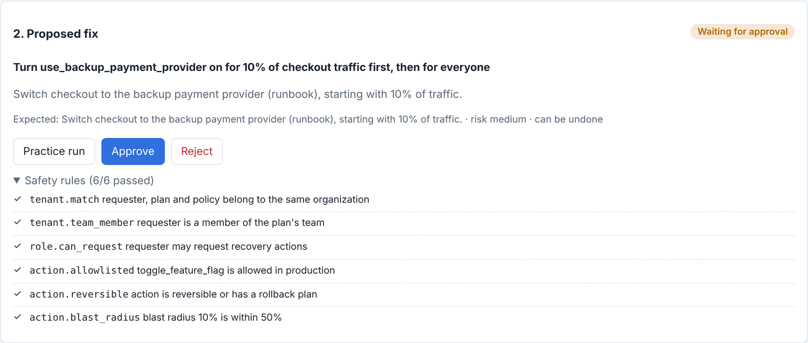

</td>
</tr>
<tr>
<td width="50%" valign="top">

### Proof that the fix worked

The fix goes to 10% of traffic first. After each stage, the verifier reads real metrics and checks them against explicit targets: error rate recovered, latency healthy, no new errors, CPU headroom. Missing data is never counted as success.

</td>
<td width="50%">

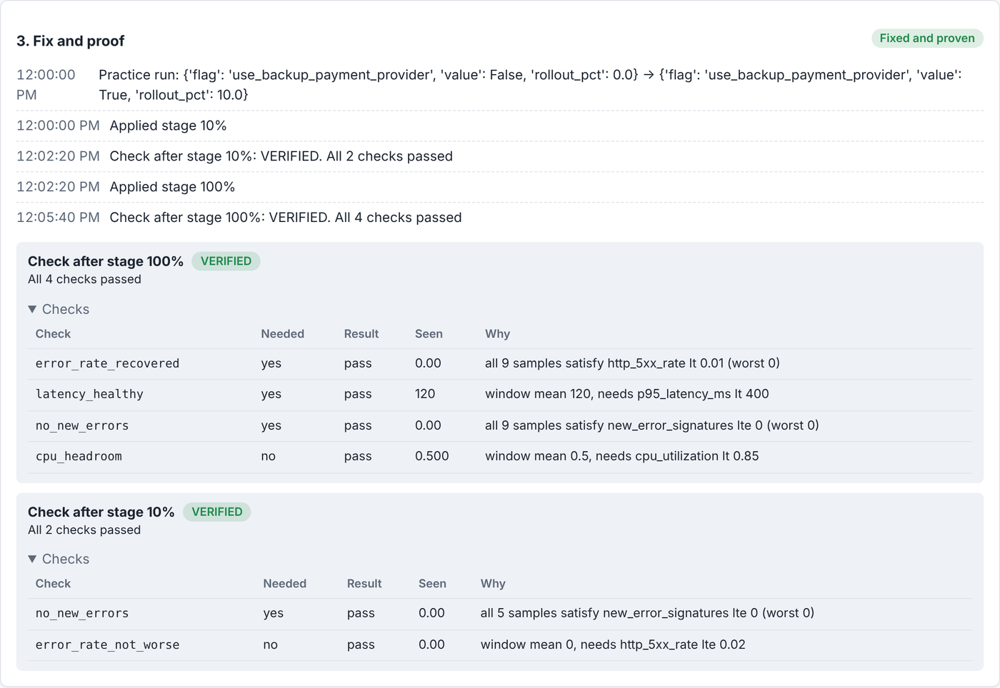

</td>
</tr>
<tr>
<td width="50%" valign="top">

### Automatic undo when a fix fails

If a check fails, for example a new error type appears, the change is undone right away and the incident stays open. The dashboard shows exactly which check failed and why.

</td>
<td width="50%">

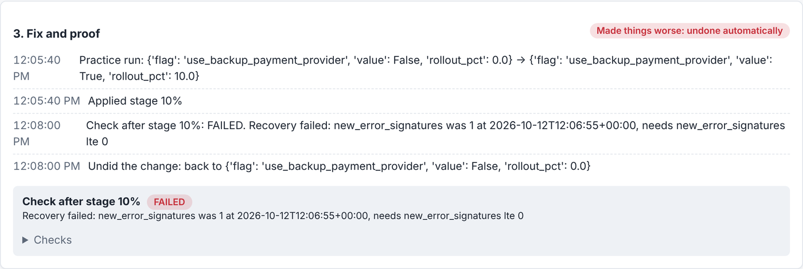

</td>
</tr>
<tr>
<td width="50%" valign="top">

### One outage, one incident

An alert joins an open incident when it comes from the same service, or from a service next to it on the dependency map within 30 minutes. Each alert shows why it was grouped, and the worst severity wins.

</td>
<td width="50%">

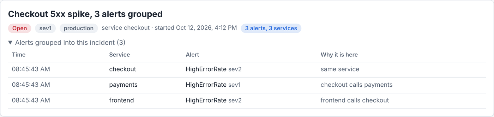

</td>
</tr>
<tr>
<td width="50%" valign="top">

### Live service map

Learned from traces: every investigation adds what it sees, and "Update from traces" reads the last hour for every service. Failing calls are dashed red, busy calls are thicker, and services with open incidents are highlighted and clickable.

</td>
<td width="50%">

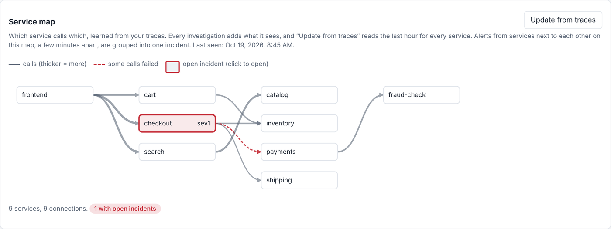

</td>
</tr>
<tr>
<td width="50%" valign="top">

### Incident memory

When the same cause happened before, the report and the chat message say what was done then and whether it worked, and warn when the proposed fix already failed once. Memory only informs people: it never changes a cause's confidence or the fix.

</td>
<td width="50%">

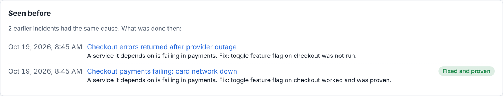

</td>
</tr>
<tr>
<td width="50%" valign="top">

### Self-service setup for every company

Each company connects its own Prometheus, Loki, Jaeger, Argo CD and Kubernetes in Settings. "Save and test" explains the result in plain words. Tokens are encrypted and never shown again. Admins manage alerts, team roles, notifications and company sign-in.

</td>
<td width="50%">

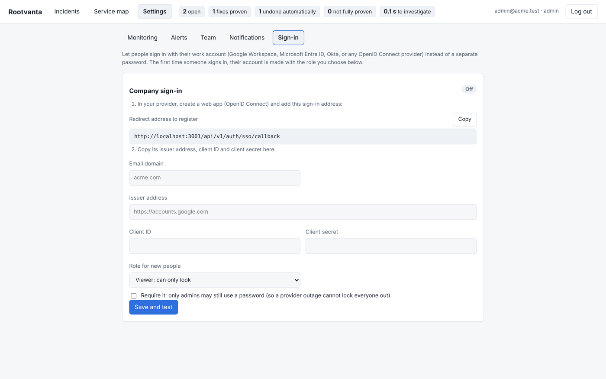

</td>
</tr>
</table>

**More capabilities:** Alertmanager and Grafana alert intake &bull; Slack-style notifications that link to the incident &bull; "Get started" checklist for new companies &bull; full audit log &bull; database job queue where a fix is never applied twice &bull; any number of workers &bull; AI cost and time per investigation &bull; practice shop with a failure injector &bull; load test &bull; one-command install &bull; Helm chart &bull; CI

---

## Quick Start

Get Rootvanta running on your machine with one command (needs [Docker](https://docs.docker.com/get-docker/)):

```bash
git clone https://github.com/anchalrajput25/rootvanta.git && cd rootvanta
./install.sh          # Windows PowerShell: .\install.ps1
```

The script creates `.env` with new random secrets, then starts PostgreSQL, the API, two workers and the dashboard. Open **http://localhost:3001**, create your company, and follow the "Get started" checklist.

> [!TIP]
> Rootvanta works without any AI key. The rule engine finds causes on its own; add `ANTHROPIC_API_KEY` only if you want Claude to re-rank causes and write the summary.

<details>
<summary><strong>Connect your systems (after the first start)</strong></summary>
<br />

1. **Settings > Monitoring**: enter your Prometheus address (and Loki and Jaeger if you have them), then "Save and test".
2. **Settings > Alerts**: create a token and paste the snippet into `alertmanager.yml` or a Grafana webhook contact point. Each alert needs a `service` label.
3. **Settings > Team**: add the people who approve and run fixes.
4. **Settings > Notifications**: add a Slack-style webhook.
5. **Settings > Monitoring**: connect Argo CD and Kubernetes so fixes can run.
6. **Settings > Sign-in** (optional): company sign-in with your identity provider.

</details>

<details>
<summary><strong>Try the whole loop on the practice shop</strong></summary>
<br />

The practice shop is three services with Prometheus, Loki, Jaeger and Grafana, plus a script that breaks things on purpose.

```bash
cd demo && docker compose up --build -d && cd ..
python -m incident_agent.workflow.demo setup     # demo company and users
uvicorn incident_agent.api.app:app               # terminal 1: the API
python -m incident_agent.workflow --demo         # terminal 2: a worker
cd demo && python inject.py payments-outage      # terminal 3: break something
```

Log in as `lead@demo-shop.test` with password `demo-password-123`. Watch the incident open, the investigation finish, approve the fix, and see the verdict. Other incidents: `bad-deploy`, `traffic-spike`. `python inject.py reset` puts everything back.

</details>

<details>
<summary><strong>Run it for development</strong></summary>
<br />

Requires Python 3.10+ and Node.js 20+.

```bash
python -m venv .venv
source .venv/bin/activate          # Windows: .venv\Scripts\activate
pip install -e ".[dev]"
uvicorn incident_agent.api.app:create_app --factory --reload    # http://localhost:8000/docs

cd web && npm install && npm run dev                            # http://localhost:3001
```

</details>

<details>
<summary><strong>Run the tests and benchmarks</strong></summary>
<br />

```bash
pytest                                              # SQLite
TEST_DATABASE_URL=postgresql+psycopg://... pytest   # adds PostgreSQL and row-level security tests
python -m incident_agent.evals.runner               # false-success scorecard
python -m incident_agent.evals.practice --cases 1000 --seed 2026
pip install -e ".[bench]" && python -m incident_agent.evals.rcaeval --download re1 --data data/rcaeval
python -m incident_agent.loadtest --api http://localhost:8000 --companies 20 --people 10 --seconds 60
```

On Windows, `run_benchmarks.bat` runs RCAEval with one double-click.

</details>

<details>
<summary><strong>Configuration</strong></summary>
<br />

| Variable | Needed | What it is |
|:---|:---|:---|
| `INCIDENT_AGENT_JWT_SECRET` | yes | Long random text that signs logins |
| `INCIDENT_AGENT_SECRET_KEY` | yes | Encrypts the tokens companies save. Back it up |
| `INCIDENT_AGENT_DATABASE_URL` | for production | PostgreSQL URL (a local SQLite file if empty) |
| `INCIDENT_AGENT_PUBLIC_URL` | for SSO and chat links | The address people open |
| `INCIDENT_AGENT_BLOCK_PRIVATE_URLS` | shared servers | `1` refuses private network addresses in Settings |
| `INCIDENT_AGENT_USE_AI` | optional | Let Claude re-rank causes (needs `ANTHROPIC_API_KEY`) |
| `WORKERS` | optional | Number of workers (more incidents at once) |

All options are in [`.env.example`](.env.example).

</details>

---

## Deploy

| Method | Best for |
|:---|:---|
| `./install.sh` / `.\install.ps1` | Trying it out, a single server |
| [Helm chart](infra/helm/incident-agent) | Production Kubernetes (GKE, EKS, AKS, on-prem) |
| [Argo CD manifest](infra/argocd/incident-agent.yaml) | GitOps installs |

### Kubernetes (Helm)

```bash
docker build -t <registry>/incident-agent-api . && docker build -t <registry>/incident-agent-web web

helm install rootvanta infra/helm/incident-agent -n rootvanta --create-namespace \
  --set image.api=<registry>/incident-agent-api --set image.web=<registry>/incident-agent-web \
  --set publicUrl=https://incidents.example.com --set ingress.host=incidents.example.com \
  --set scaling.namespaces='{shop,payments}'
```

The chart runs the API, workers and dashboard with autoscaling, disruption budgets, an Ingress, optional PostgreSQL, and scale-only permissions in the namespaces you list. For production, use your own PostgreSQL with a role that is not a superuser, so row-level security applies.

---

## How It Works

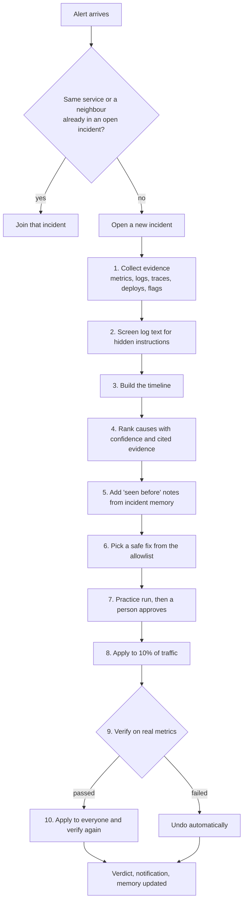

<details>
<summary><strong>Sequence: from alert to proven recovery</strong></summary>
<br />

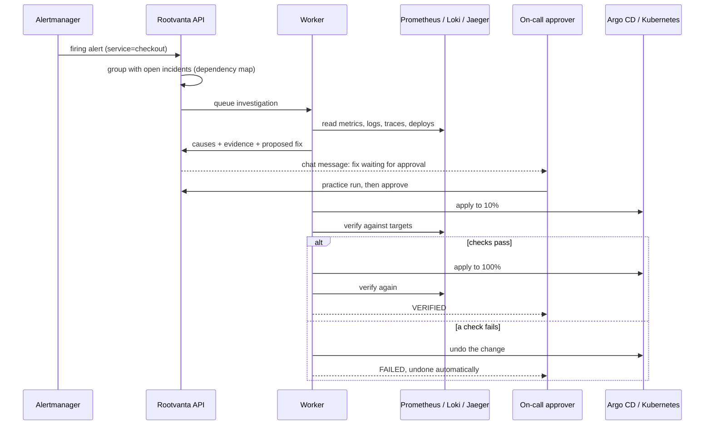

</details>

1. **Group.** Alerts are grouped by service and by the learned dependency map within a 30-minute window.
2. **Investigate.** The investigator finds which services the alerting one calls, reads their error rate, latency and CPU, groups error logs by type, lists recent deploys and flag changes, and finds where failing requests start.
3. **Decide.** Rules rank the causes in about 40 ms. With the AI step on, Claude re-ranks them and writes the summary, but must cite real evidence ids or its answer is dropped. Below 60% confidence the answer is "not enough evidence".
4. **Fix.** The fix is chosen in code, checked by the safety policy, previewed, and approved by a person.
5. **Prove.** After each stage the verifier compares real metrics with explicit targets. FAILED undoes the change; not enough data means it is not widened.

---

## Integrations

<div align="center">

**Works today**


**AI:** Anthropic Claude (optional) &bull; the rule engine needs no AI at all

**Planned**


</div>

---

## Benchmarks

Every number below can be reproduced with the command next to it. Full details, including the weak spots, are in [`evals/RESULTS.md`](evals/RESULTS.md).

### False success, the main goal

`python -m incident_agent.evals.runner`

| | Rootvanta | Naive baseline ("the action ran, so it's fixed") |
|:---|:---:|:---:|
| **False-success rate** | **0%** | 100% |
| Unsafe actions executed | 0 | n/a |

### Finding the right cause: 1,000 practice incidents

`python -m incident_agent.evals.practice --cases 1000 --seed 2026`

Generated incidents with known causes plus distractions: harmless deploys, old noisy errors, one-off spikes, missing traces or logs, and log text that tries to give orders. Tuning was done on a different seed.

| Metric | Before tuning | Now |
|:---|:---:|:---:|
| **Named the right cause** | 53.1% | **88.9%** |
| **Confidently wrong** | 16.6% | **1.8%** |
| Right cause on top (AC@1) | 66.0% | 89.8% |
| False alarms on 148 healthy cases | 0 | 0 |
| Right fix, when the cause was right | 100% | 100% |
| Time per investigation (p50 / p95) | 39 / 62 ms | 40 / 60 ms |

### RCAEval: 735 real failure cases (public benchmark)

| Method | AC@1 | Avg@5 |
|:---|:---:|:---:|
| BARO (published, FSE 2024) | 0.50 | 0.83 |
| **Rootvanta** | **0.49** | **0.82** |

Level with a recent published method, not better yet. Using logs and traces better is the next milestone.

### Many companies at once: load test

One 4-core machine running PostgreSQL, 4 API processes, 4 workers and the load generator:

| People at once | Companies | List incidents p50 / p95 | Alert to finished investigation (p50) | Data seen by another company |
|:---:|:---:|:---:|:---:|:---:|
| 100 | 10 | 13 / 55 ms | 1.3 s | **0** |
| 250 | 25 | 49 / 59 ms | 1.4 s | **0** |
| 500 | 50 | 56 / 1,760 ms | 1.9 s | **0** |

Company data never leaked in 625 checks, even when overloaded. The API keeps no state between requests, so it scales by adding processes or machines.

---

## Architecture

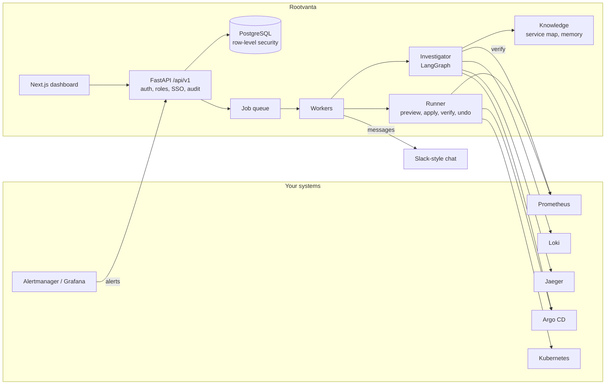

```
rootvanta/
├── src/incident_agent/
│   ├── api/             # FastAPI routes, auth, roles, audit log
│   ├── auth/            # OpenID Connect sign-in (SSO)
│   ├── db/              # SQLAlchemy models and row-level security
│   ├── domain/          # Organizations, incidents, evidence, actions
│   ├── safety/          # Deny-by-default safety policy
│   ├── investigation/   # Evidence collectors, rules, LangGraph pipeline, optional Claude step
│   ├── remediation/     # Argo CD, Kubernetes and flag executors, gradual rollout, auto-undo
│   ├── verification/    # VERIFIED / PARTIALLY VERIFIED / FAILED / UNVERIFIED
│   ├── knowledge/       # Dependency map and incident memory
│   ├── integrations/    # Per-company connections, encrypted tokens, connection test
│   ├── telemetry/       # Prometheus, Loki and Jaeger clients
│   ├── workflow/        # Job queue, workers, notifications
│   └── evals/           # Scorecard, practice benchmark, RCAEval runner
├── web/                 # Next.js 16 dashboard
├── demo/                # Practice shop, monitoring stack, failure injector
├── infra/               # Helm chart, Argo CD manifest, PostgreSQL setup
├── evals/               # Scenarios and RESULTS.md
└── tests/               # pytest suite (254 tests)
```

| Layer | Stack |
|:---|:---|
| AI orchestration | LangGraph, rule engine, optional Anthropic Claude |
| Backend | Python, FastAPI, Pydantic, SQLAlchemy |
| Workers | Database job queue (claimed with row locks, never runs a fix twice) |
| Frontend | Next.js 16, React 19, TypeScript |
| Storage | PostgreSQL with row-level security (SQLite for local runs) |
| Telemetry | Prometheus, Loki, Jaeger |
| Change systems | Argo CD, Kubernetes, feature flags, custom admin APIs |
| Deployment | Docker Compose, Helm, Argo CD |

---

## Security

- **Company separation in the database itself:** PostgreSQL row-level security with `FORCE ROW LEVEL SECURITY` and a non-superuser app role, so even a query that forgets to filter cannot read another company's rows.
- **Roles:** admin, approver, responder and viewer, checked on every request. A deactivated user loses access at once.
- **Two-person rule:** a fix must be approved by a different person in the same company who holds the approver role.
- **Deny-by-default safety policy** in code: allowlisted, reversible actions with limited blast radius and scale limits.
- **Prompt-injection screening:** log text is treated as data, cleaned, and screened for hidden instructions before any AI step.
- **Secrets:** scrypt password hashes, signed tokens, Fernet-encrypted monitoring tokens that are never sent back to the browser.
- **Safe addresses:** cloud metadata addresses are always refused; shared servers can refuse private networks too.
- **Audit log:** every sign-up, login, incident, plan, approval and verification is recorded in the same transaction as the change.

---

## Data Privacy

Rootvanta is **self-hosted**. Your incident data stays on your own servers.

- All data lives in your own PostgreSQL, on Docker or Kubernetes
- No telemetry or tracking
- Monitoring tokens are encrypted at rest
- The AI step is off by default; when on, only cleaned, shortened evidence goes straight from your server to Anthropic

---

## Roadmap

Rootvanta is **actively in development**. Here is where it stands:

| # | Milestone | Status |
|:---:|:---|:---:|
| 1 | Deterministic core: safety policy, verification, scenarios, scorecard | ✅ Done |
| 2 | Multi-company API: row-level security, roles, audit log | ✅ Done |
| 3 | Practice environment: shop, Prometheus, Loki, Jaeger, Grafana, failure injector | ✅ Done |
| 4 | Investigation agent with cited evidence and timeline | ✅ Done |
| 5 | Safe fixing: workers, practice run, approval, gradual rollout, auto-undo | ✅ Done |
| 6 | Next.js dashboard | ✅ Done |
| 7 | Self-service setup, encrypted tokens, one-command install, CI | ✅ Done |
| 8 | Benchmarks: practice set, RCAEval, AI cost, load test | ✅ Done |
| 9 | Argo CD and Kubernetes connectors, SSO, Helm chart, chat links | ✅ Done |
| 10 | Alert grouping, dependency map, incident memory, each service's own normal | ✅ Done |
| 11 | Better log and trace fusion on RCAEval (held-out split), small fine-tuned ranking model | 🚧 In progress |

**Coming next**

- [ ] PagerDuty, Opsgenie and Datadog alert intake
- [ ] Two-way Slack and Microsoft Teams: approve and run fixes from chat
- [ ] More fix types: restart pods, config rollbacks, traffic shifting
- [ ] Auto-generated postmortems with timeline, cause, impact and verified recovery
- [ ] OpenTelemetry-native evidence collection
- [ ] A public, continuously updated false-success rate across installs
- [ ] Hosted demo and documentation site

Full milestone details are in [`docs/MILESTONES.md`](docs/MILESTONES.md).

---

## Limitations

Honest about what does not work yet:

- Level with BARO on RCAEval, not better; logs and traces currently hurt results on Online Boutique.
- With no logs, deploys are hard to see, and without traces the agent often stays unsure about dependencies.
- The practice benchmark is generated by this project, so it is a practice test, not independent proof.
- Fixes are limited to rollback, feature-flag fallback and scaling for now.
- In-cluster Kubernetes service-account mode is only for single-company installs.

---

## Contributing

Contributions are welcome while the project is moving fast.

- **[Issues](https://github.com/anchalrajput25/rootvanta/issues)**: bug reports and feature ideas
- **[Contributing guide](CONTRIBUTING.md)**: how to run the tests and send a pull request

---

## License

Not chosen yet. Until a license file is added, all rights are reserved.

---

<div align="center">
<br />
<strong>Rootvanta is actively in development. If it is useful or interesting to you, <a href="https://github.com/anchalrajput25/rootvanta">star it on GitHub</a> to follow along.</strong>
<br /><br />
<a href="https://github.com/anchalrajput25/rootvanta/stargazers"></a>
<br /><br />
Built by <a href="https://github.com/anchalrajput25">Anchal Rajput</a>
</div>
